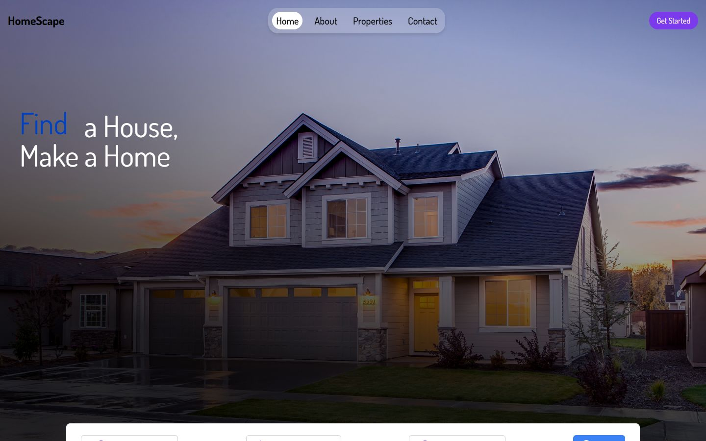
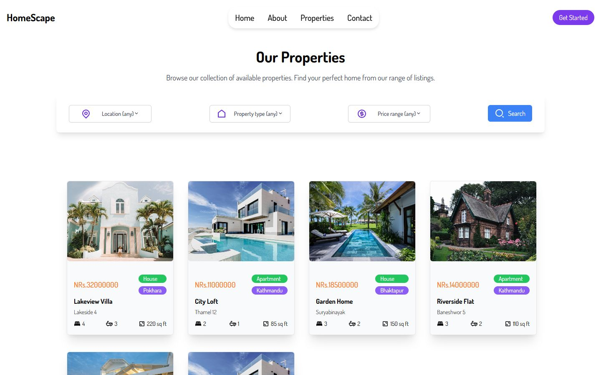
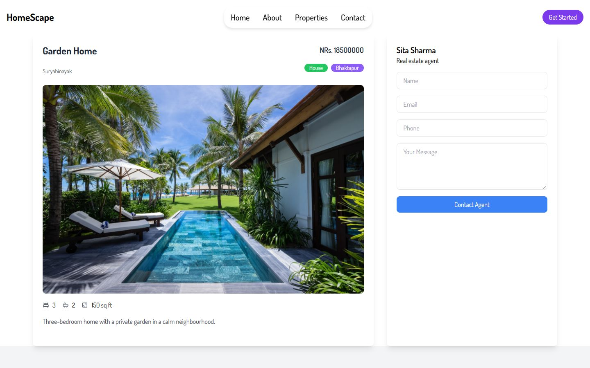
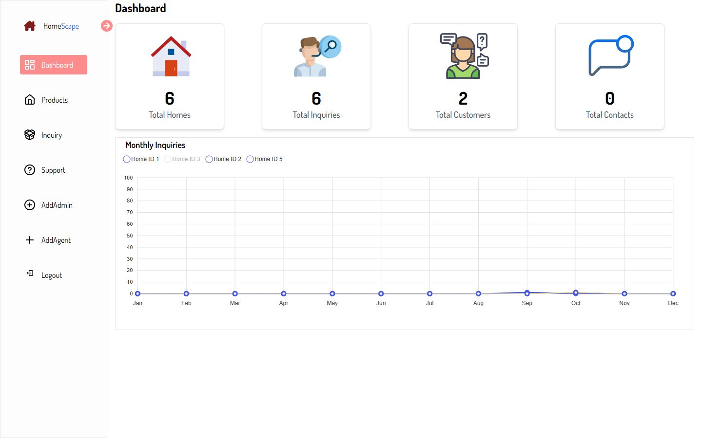
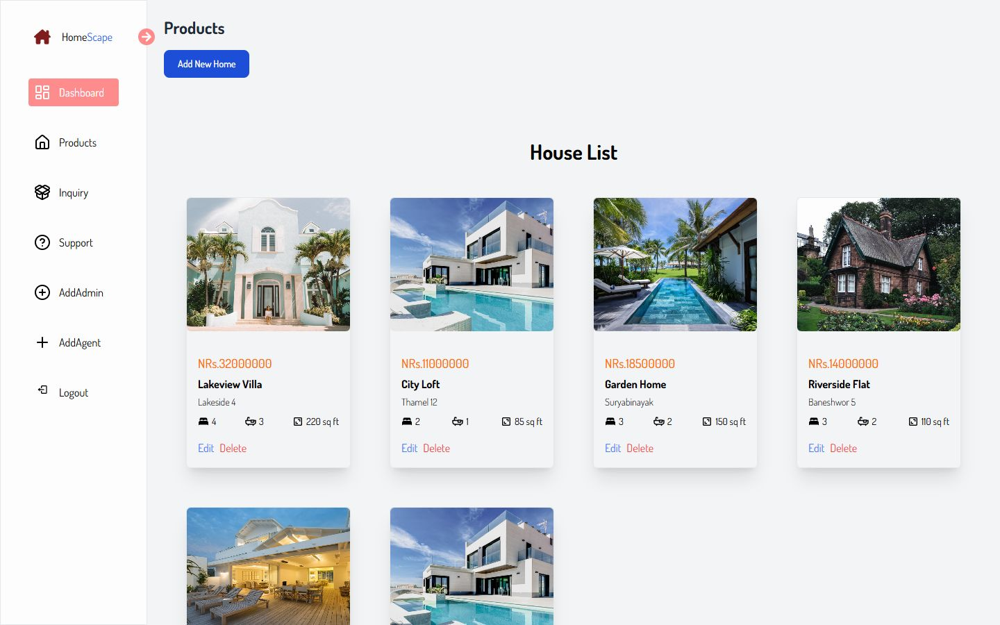
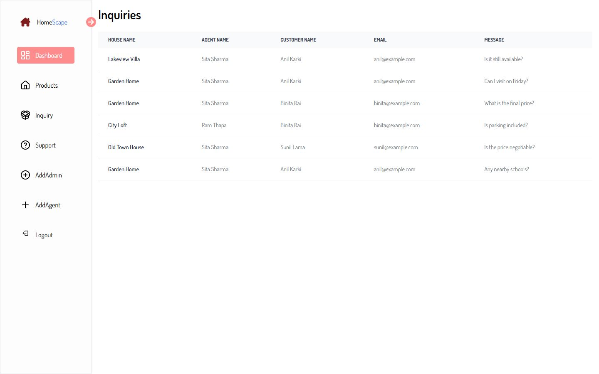

# 🏠 HomeScape Frontend

HomeScape is a property-listing platform. Visitors browse homes and filter them by city, type and price, open a home to see its photo, price and agent, and send the agent an inquiry. An admin manages homes, agents, customers and inquiries from a dashboard.

This repository is the React frontend. It talks to the Spring Boot backend, [HomeScapeBackend](https://github.com/AaryanBasnet/HomeScapeBackend), over REST.

> **About this project.** HomeScape was built in mid-2024 as an early full-stack project (Java, SQL and React), mostly on my own. It was updated in November 2026: the API address is now one setting instead of 42 copies, the admin area checks the admin role, a dashboard chart that only counted 2024 was fixed, and this README was written. See [Known limits](#-known-limits) for what is still weak.

### At a glance

| | |
| --- | --- |
| **2 areas** | A public website (home, properties, property details, about, contact, sign in) and an admin dashboard |
| **45 React components** | About 4,000 lines of JSX |
| **Filter by city, type and price** | The filter is sent to the backend, which runs one query with optional conditions |
| **Admin tools** | Homes (add, edit, delete, with photos), agents, customers, inquiries, a monthly-inquiries chart |
| **JWT login** | Tokens are kept in the browser and refreshed with a refresh token |

### Screenshots

| Home | Browse and filter |
| --- | --- |
|  |  |
| **A property and its agent** | **Admin dashboard** |
|  |  |
| **Admin: manage homes** | **Admin: inquiries** |
|  |  |

The screenshots show made-up demo data (homes, agents and prices are invented). The house photos are stock images used as placeholders.

## ✨ How it works

- **Browse.** The Properties page loads homes from the API. The search bar (city, property type, price range) calls `GET /home/filter`, so the backend does the filtering and the page only shows the result.
- **Details and inquiry.** A property page shows the photo, price, rooms, size and the agent. A signed-in visitor can send the agent an inquiry; the backend links it to the visitor and to the home.
- **Sign in.** Register or log in. The backend returns a JWT and a refresh token, which are kept in `localStorage`. An admin is sent to the dashboard, everyone else to the home page.
- **Admin.** The dashboard shows totals (homes, inquiries, customers, contacts) and a line chart of inquiries per month for each home. The other pages add, edit and delete homes (with a photo upload), manage agents, and list customers and inquiries.

## 🚀 Features

- Home page with a search bar, property listing with filters, property details with the agent
- Contact and About pages; the About text is edited from the admin area and contact messages are listed in its Support page
- Registration, login, logout and token refresh
- Admin: homes with photo upload, agents, customers, inquiries, dashboard with a chart
- Toast messages for success and errors, loading placeholders, responsive layout (Tailwind)

## 🛠 Tech stack

React 18 · Vite 5 · Tailwind CSS · React Router 6 · Axios · TanStack Query · ApexCharts · Framer Motion and GSAP · Headless UI · React Toastify

## ⚙️ Getting started

You need a recent Node.js (18 or newer) and the [backend](https://github.com/AaryanBasnet/HomeScapeBackend) running.

```bash
git clone https://github.com/AaryanBasnet/HomeScapeFrontend.git
cd HomeScapeFrontend
npm install
npm run dev          # http://localhost:5173
```

By default the app calls the backend at `http://localhost:8080`. To use another address:

```bash
cp .env.example .env.local     # then edit VITE_API_BASE_URL
```

### Environment variables

| Variable | Needed | What it is |
| --- | --- | --- |
| `VITE_API_BASE_URL` | no | The backend address, without a trailing slash. Default `http://localhost:8080` |

## 📜 Scripts

| Command | What it does |
| --- | --- |
| `npm run dev` | Start the development server |
| `npm run build` | Build for production into `dist/` |
| `npm run preview` | Serve the production build locally |
| `npm run lint` | Run ESLint |

## 📁 Project structure

```
src/
  pages/      Home, Properties, PropertyDetails, About, Contact, sign in, unauthorized
  website/    components of the public site (search, filters, house card, navbar, footer)
  admin/      the admin area: dashboard, products (homes), customers, inquiries, agents, support
  utils/      small helpers
  config.js   the API address (VITE_API_BASE_URL)
  App.jsx     routes and the admin guard
```

## 🚧 Known limits

- **The admin guard only hides screens.** The admin pages open only for a user whose saved roles include `ADMIN`, but that is stored in the browser, and the backend does not check roles yet. Real access control has to be added in the API (see the backend README).
- **No tests.** The code has not been covered by automated tests.
- **Lint is not clean.** `npm run lint` reports about 115 problems (mostly unused variables and missing prop types) that were there before this update.
- The monthly-inquiries chart has a fixed 0 to 100 scale, so small numbers look flat.
- Photos come from the backend's disk, so the backend must be running for any image to show.

## 📬 Author

Aaryan Basnet · [GitHub](https://github.com/AaryanBasnet) · [LinkedIn](https://www.linkedin.com/in/aaryan-basnet)
